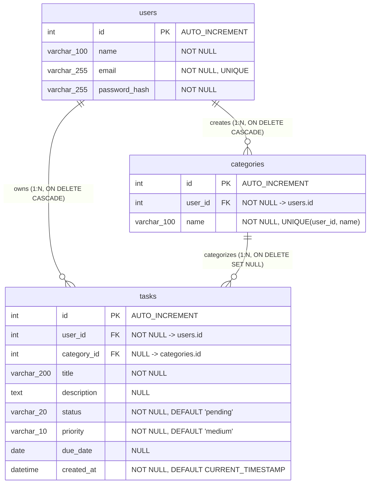

# Entity-Relationship (ER) Diagram: To-Do Application

This document defines the Entity-Relationship model for the `todo_db` schema.

---

## 1. Mermaid ER Diagram



---

## 2. Relationships & Cardinality

| Relationship | Cardinality | Foreign Key | Delete Rule | Description |
| :--- | :---: | :--- | :--- | :--- |
| **users -> categories** | 1 to 0..N | `categories.user_id -> users.id` | `ON DELETE CASCADE` | Each user can create multiple categories. Removing a user deletes all their categories. |
| **users -> tasks** | 1 to 0..N | `tasks.user_id -> users.id` | `ON DELETE CASCADE` | Each user can own multiple tasks. Removing a user deletes all their tasks. |
| **categories -> tasks** | 0..1 to 0..N | `tasks.category_id -> categories.id` | `ON DELETE SET NULL` | Tasks can optionally belong to a category. Removing a category keeps the tasks intact with `category_id = NULL`. |

---

## 3. Constraints & Indexes Summary

### Unique Constraints
- `users.email` (UNIQUE): Guarantees unique email addresses across all accounts.
- `categories(user_id, name)` (UNIQUE): Prevents duplicate category names for the same user while allowing different users to use identical names (e.g. both Alice and Bob can have a "Work" category).

### Check Constraints (MySQL 8.0.16+)
- `chk_tasks_status`: `status IN ('pending', 'in_progress', 'completed')`
- `chk_tasks_priority`: `priority IN ('low', 'medium', 'high')`

### Indexes
- `idx_tasks_user_id`: `tasks(user_id)` - Fast lookups for all tasks belonging to a specific user.
- `idx_tasks_user_id_status`: `tasks(user_id, status)` - Composite index for filtered dashboard views by status (e.g., active vs. completed tasks).
- `idx_tasks_due_date`: `tasks(due_date)` - Fast sorting and range queries for upcoming or overdue deadlines.

---

## 4. How to Export to `er-diagram.png`

You can export this Mermaid diagram to `er-diagram.png` using any of the following methods:

### Method A: Using Mermaid CLI (`mmdc`)
```powershell
# Run using npx (requires Node.js)
npx -p @mermaid-js/mermaid-cli mmdc -i database/er-diagram.md -o database/er-diagram.png
```

### Method B: Mermaid Live Editor
1. Visit [mermaid.live](https://mermaid.live).
2. Copy the `erDiagram` code block above into the editor.
3. Click **Actions** -> **PNG** -> **Download PNG**.
4. Save the file to `database/er-diagram.png`.

### Method C: VS Code Extension
1. Install the **Markdown Preview Mermaid Support** extension.
2. Open `database/er-diagram.md` in preview mode (`Ctrl + Shift + V`).
3. Right-click the rendered diagram and select **Save image as...** -> `database/er-diagram.png`.
